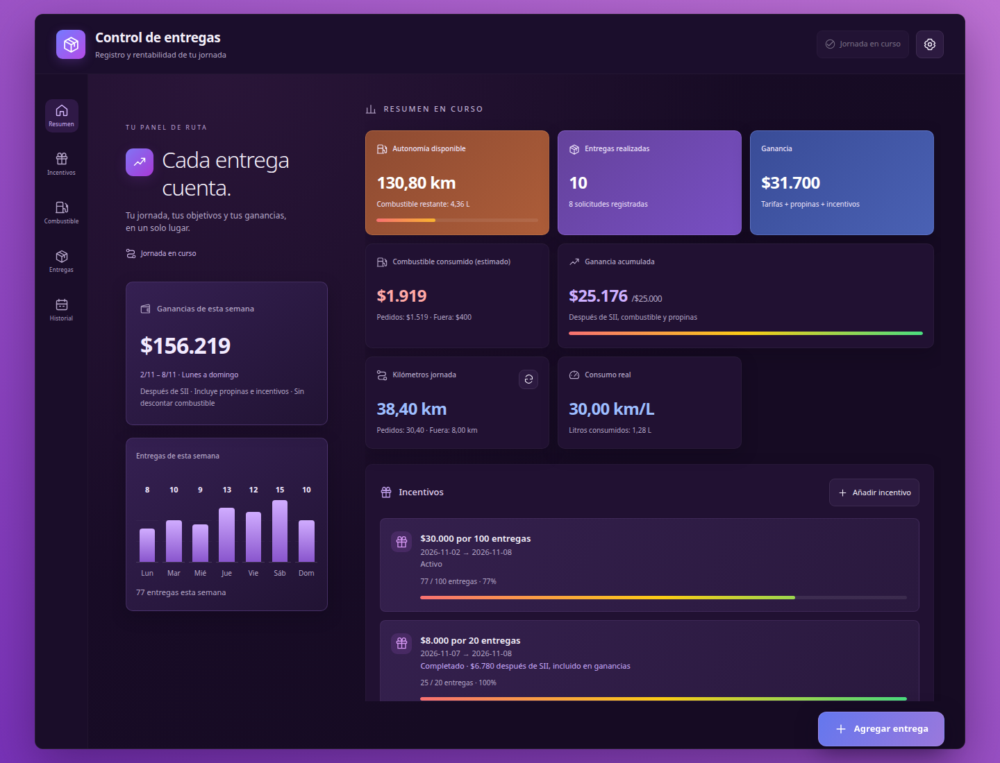
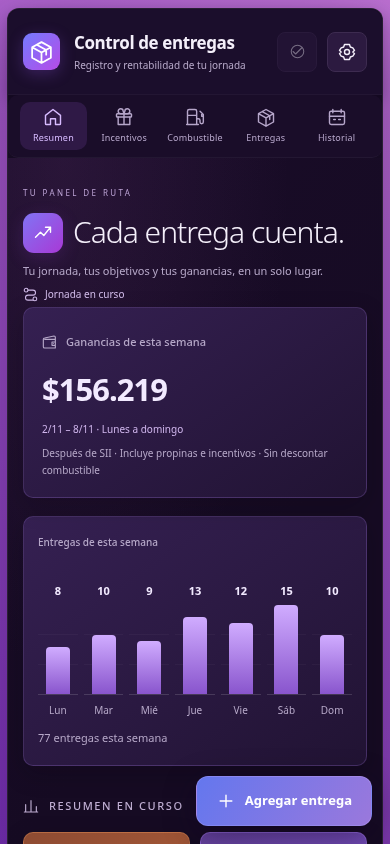
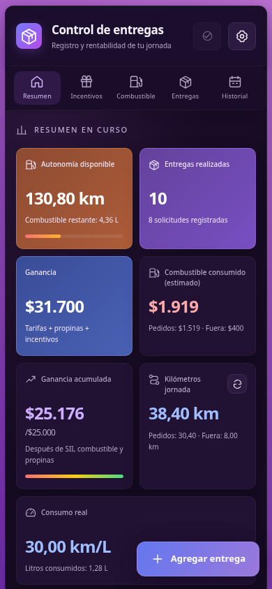

# Control de entregas

Aplicación para registrar solicitudes de reparto, calcular ganancias estimadas, seguir incentivos y controlar el combustible de la jornada. Los importes se muestran en pesos chilenos (CLP), las distancias en kilómetros y el combustible en litros.

## Vista de la aplicación

Capturas con el respaldo ficticio incluido, tomadas en Chromium con fecha de demostración **8 de noviembre de 2026, 23:30, America/Santiago**. Muestran la semana del lunes 2 al domingo 8 de noviembre.

| Inicio en móvil | Indicadores de la jornada en móvil |
| --- | --- |
|  |  |

## Comenzar a usarla

Abre la aplicación en tu navegador. Si tienes los archivos del proyecto en tu equipo, abre `index.html`. Puedes usarla desde escritorio o móvil; no requiere crear una cuenta.

1. Abre **Configuración**, con el icono de engranaje.
2. Revisa el precio del combustible, rendimiento aproximado, litros iniciales, capacidad del estanque, retención y odómetro inicial predeterminado. Los cambios se guardan automáticamente.
3. Pulsa **Agregar entrega** para registrar tu primera solicitud.

La primera apertura crea una jornada con parámetros de ejemplo. Ajusta los valores a tu vehículo antes de registrar datos reales. El odómetro inicial predeterminado no cambia el inicio de una jornada que ya está creada; confirma la lectura inicial al iniciar una nueva jornada.

Los datos se guardan en este navegador. No se sincronizan entre dispositivos y pueden perderse al borrar sus datos. Exporta un respaldo periódicamente.

## Probar el respaldo de ejemplo

[Descargar el respaldo demo](respaldo-entregas-uber.json.example) usando **Raw / Descargar archivo** en GitHub. Guárdalo o renómbralo como `respaldo-entregas-uber.json` para seleccionarlo en el importador.

1. Si ya tienes registros, ve a **Configuración → Respaldo JSON** para conservar una copia.
2. Pulsa **Importar respaldo** y selecciona el archivo demo con extensión `.json`.
3. Comprueba el mensaje **Respaldo importado** y cierra la configuración.

**Importar reemplaza los datos actuales; no los combina.** El respaldo contiene exclusivamente datos ficticios:

- 60 solicitudes y 77 entregas distribuidas de lunes a domingo.
- Seis jornadas finalizadas y la del domingo abierta.
- Cargas de combustible, propinas, recorridos fuera de pedido y dos incentivos: uno completado y otro al 77 % en la fecha de demostración.

| Día | Lunes | Martes | Miércoles | Jueves | Viernes | Sábado | Domingo |
| --- | ---: | ---: | ---: | ---: | ---: | ---: | ---: |
| Entregas | 8 | 10 | 9 | 13 | 12 | 15 | 10 |

El gráfico y las ganancias semanales usan **la semana actual del dispositivo**, no la semana del respaldo. Si importas este ejemplo fuera del 2–8 de noviembre de 2026, esos indicadores pueden estar vacíos y el incentivo incompleto aparecerá finalizado. Los registros importados se conservan. Las capturas usan una fecha fija de demostración; no necesitas cambiar el reloj de tu dispositivo.

## Registrar y corregir entregas

1. Pulsa **Agregar entrega**.
2. Indica cantidad de entregas, tarifa total, distancia y propina, si corresponde.
3. Revisa el cálculo previo y pulsa **Guardar entrega**.

Una solicitud puede incluir varias entregas. La cantidad **no multiplica** la tarifa ni la distancia: introduce los totales de la solicitud.

En **Entregas**, usa el lápiz para editar y la cruz para eliminar, previa confirmación. En móvil también puedes duplicar una solicitud con el icono de copia; la copia queda registrada con la fecha y hora actuales. Editar una solicitud conserva su fecha original.

## Jornadas y odómetro

- **Actualizar odómetro:** pulsa el icono junto a **Kilómetros jornada**, introduce la lectura actual y confirma. No puede ser inferior a la lectura mínima calculada a partir de los registros.
- **Finalizar jornada:** introduce el odómetro final y confirma. La jornada pasa al historial y se deshabilita el registro de nuevas entregas y cargas hasta reanudarla o iniciar otra.
- **Reanudar jornada:** permite continuar una jornada finalizada del día actual.
- **Nueva jornada:** configura odómetro inicial, combustible disponible, precio, ganancia objetivo, retención, rendimiento y capacidad. Se proponen el odómetro final y el combustible restante de la última jornada finalizada. Revisa los valores antes de iniciar.

Los controles de jornada están en la cabecera; en móvil se muestran como iconos. Si hay una jornada del día en curso, el botón aparece deshabilitado. El historial muestra las jornadas finalizadas; pulsa la flecha para consultar su resumen.

## Combustible y autonomía

En **Combustible → Cargar combustible**, introduce litros comprados, precio por litro y odómetro actual. El formulario muestra el importe y el espacio estimado disponible. Guarda la carga para actualizar los indicadores.

- La barra de autonomía representa los litros restantes respecto a la capacidad del estanque: lleno equivale al **100 %**.
- Con **1 litro o menos**, aparece **Reserva** y la barra se vuelve roja.
- Los kilómetros disponibles se estiman con los litros restantes y el rendimiento configurado.
- Las cargas compradas se muestran separadas del gasto por consumo estimado.

La aplicación calcula el combustible; no lee un sensor del vehículo. Actualiza el odómetro para incluir recorridos fuera de los pedidos. Si la distancia registrada supone consumir todo el combustible cargado o más, al actualizar el odómetro o finalizar la jornada la aplicación puede recalcular el rendimiento.

## Incentivos

1. Abre **Incentivos → Añadir incentivo**.
2. Indica la meta de entregas, monto y fechas de inicio y término.
3. Pulsa **Guardar incentivo**.

Se cuentan las entregas de todas las jornadas dentro de las fechas, inclusive, según la hora local. Al completar la meta, el incentivo se incorpora a la jornada de la entrega que la completó, descontando la retención configurada al crear el incentivo. La barra muestra su avance de rojo a amarillo y verde.

## Interpretar los indicadores

| Indicador | Qué representa |
| --- | --- |
| Entregas realizadas | Suma de entregas de la jornada; debajo aparece el número de solicitudes. |
| Ganancia | Tarifas, propinas e incentivos obtenidos, antes de descontar retención y combustible. |
| Ganancia acumulada | Ingreso después de retención, más propinas, menos combustible consumido estimado. La barra compara este importe con la ganancia objetivo. |
| Ganancias de esta semana | Ingresos después de retención, incluidas propinas e incentivos obtenidos; no descuenta combustible. |
| Entregas de esta semana | Cantidad diaria de lunes a domingo, considerando todas las jornadas de la semana actual. |
| Kilómetros jornada | Lectura del odómetro y distancias registradas; distingue pedidos y recorridos fuera de pedido. |
| Consumo real | Relación calculada entre kilómetros y litros estimados; requiere una lectura de odómetro. No es una medición directa del estanque. |

Las propinas no reciben retención en los cálculos de la aplicación. La ganancia objetivo se establece al crear una nueva jornada.

En móvil, **Resumen** vuelve al inicio. Después de los indicadores aparecen incentivos, combustible, entregas e historial. En escritorio, la columna de información semanal y la de operaciones tienen desplazamiento independiente.

## Guardar y recuperar tus datos

En **Configuración**:

- **Respaldo JSON:** exporta parámetros, jornadas, entregas, incentivos y cargas para recuperarlos posteriormente.
- **Importar respaldo:** restaura un JSON exportado y reemplaza los datos actuales.
- **Exportar CSV:** descarga las entregas para consultarlas en una hoja de cálculo; no sustituye al respaldo completo.
- **Restablecer datos:** elimina los registros y restaura los parámetros iniciales tras pedir confirmación.

Para llevar los datos a otro navegador o dispositivo, exporta el JSON e impórtalo allí.

## Problemas habituales

- **El archivo no es un respaldo válido:** selecciona un respaldo JSON de la aplicación. Para el demo, quita `.example` del nombre.
- **La carga supera el espacio del estanque:** revisa litros, capacidad y odómetro antes de guardar.
- **Odómetro no válido o menor que los km de pedidos:** comprueba la lectura y las distancias registradas; el odómetro no puede retroceder.
- **Jornada finalizada:** reanuda la jornada del día o inicia una nueva para registrar entregas o combustible.
- **Semana sin entregas tras importar:** comprueba las fechas del respaldo; el gráfico siempre corresponde a la semana actual.

Esta guía describe los controles y cálculos implementados en [index.html](index.html). Las imágenes se generaron importando el respaldo demo mediante el formulario de la aplicación.
